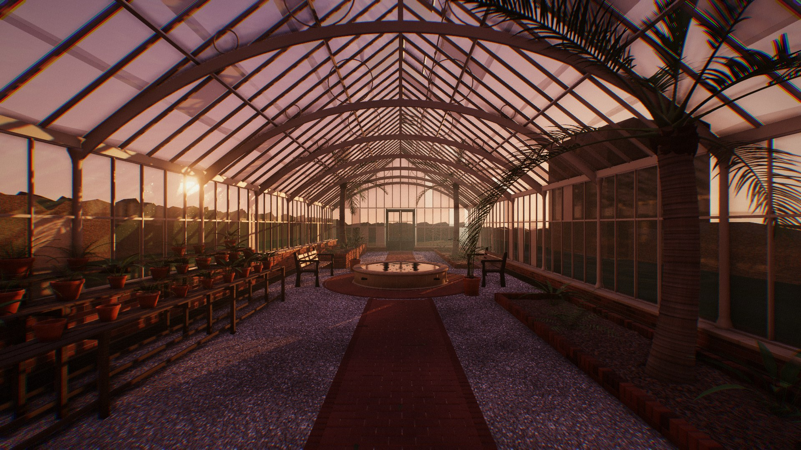
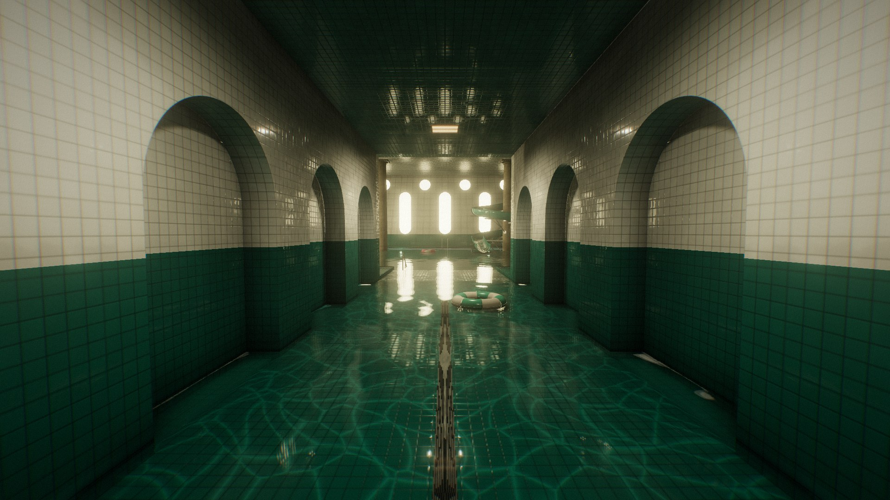
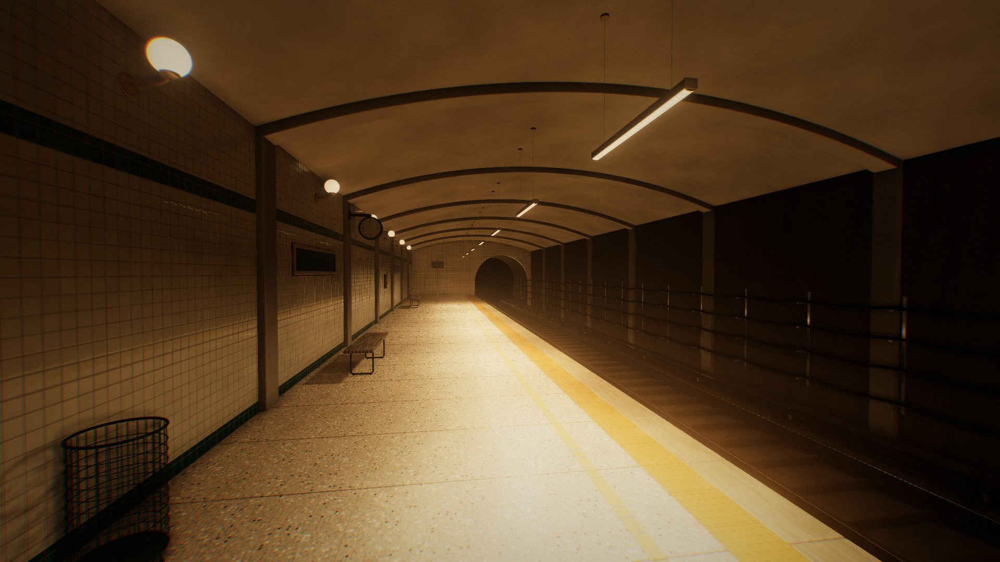

# dreamcore

A calm first-person walk through empty, dreamlike places: tiled pools, a hotel corridor, a mall after hours, a metro platform after the last train, a glasshouse at dusk. It runs in the browser on three.js with no build step, and every texture and object is generated in code.

**Play it: https://dan-k391.github.io/dreamcore/**





## Controls

| Key | Action |
| --- | --- |
| Click | enter (captures the mouse) |
| Mouse | look |
| W A S D | walk |
| Shift | run |
| Space | jump |
| C | zoom |
| Q / E | turn (when the mouse can't be captured) |
| P or Esc | pause and settings (sound, visual quality) |
| F | show or hide the fps readout |
| M | mute |
| V | noclip: fly through walls (Space up, X down, Shift faster) |

## Run it locally

```bash
node tools/serve.mjs 8200
```

Then open http://127.0.0.1:8200/. How the project is built and tested: [AGENTS.md](AGENTS.md) and [docs/](docs/).
